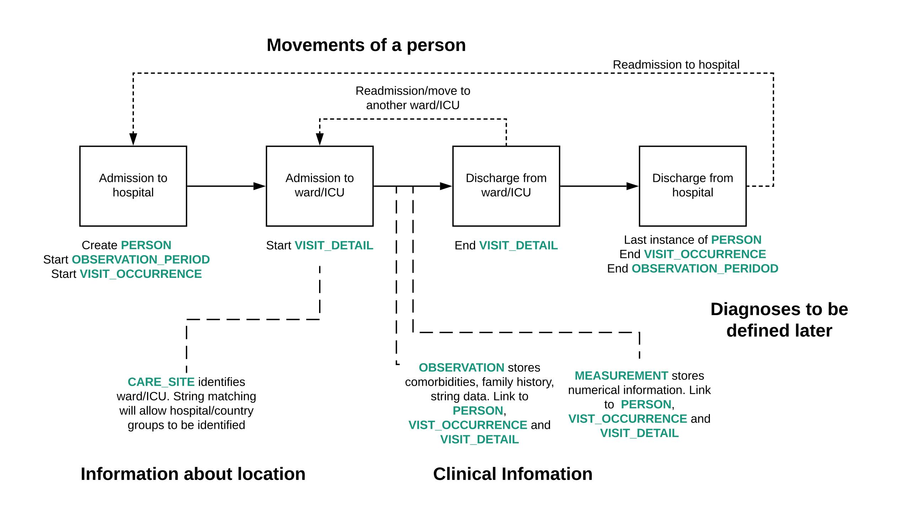

<style>
h1.title { font-size: 38px; text-align: center; }
h4.date  { font-size: 18px; text-align: center; }
</style>

```{r setup, include=FALSE}
library(knitr)
library(kableExtra)
library(ggplot2)
library(dplyr)
library(tidyr)
library(purrr)
library(stringr)
library(readr)
library(DBI)
library(dbplyr)
library(lubridate)
library(patchwork)

opts_chunk$set(echo = FALSE, warning = FALSE, error = FALSE, message = FALSE,
               out.width = "100%", dpi = 300)

ccaa <- params$local_hospital == "CCAA"

source("R/utils.R")
source("R/plots.R")
```

<br>
<font size="4">Reporting Period: `r params$start_date` to `r params$end_date`</font>
<br><br>

```{r load-data}
ctn        <- setup_ctn(params)
period_ids <- get_period_patients(ctn, params$schema, params$start_date, params$end_date)

obs_period   <- tbl(ctn, in_schema(params$schema, "observation_period")) |>
  filter(person_id %in% period_ids) |> collect()
visit_detail <- tbl(ctn, in_schema(params$schema, "visit_detail")) |>
  filter(person_id %in% period_ids) |>
  collect() |>
  apply_concept_names(ctn, params$schema)

st           <- prepare_tables(ctn, params$schema) |>
  map(~ filter(., person_id %in% period_ids))
overview     <- prepare_overview(st)
care_sites   <- unique(st[["person"]]$care_site_id)
table_counts <- prepare_tally(ctn, params$schema,
                               filter_person_ids = period_ids,
                               filter_care_sites = care_sites)
zero_vals    <- table_counts |> filter(n == 0) |> pull(table)

glossary <- read_csv(system.file("data", "glossary.csv", package = "ccaa.inspectEHR"),
                     show_col_types = FALSE)

# SQL summaries (end_date bug fixed – was params$end_dat in the original)
run_sql <- function(file, schema, start_date, end_date) {
  readr::read_file(system.file(file, package = "ccaa.inspectEHR")) |>
    stringr::str_replace_all(":OMOP_SCHEMA", schema) |>
    stringr::str_replace_all("date_start",   start_date) |>
    stringr::str_replace_all("date_end",     end_date) |>
    DBI::dbGetQuery(ctn, x = _) |>
    tibble::as_tibble()
}

meas_obs_summary <- run_sql("measurement_observation_summary.sql",
                             params$schema, params$start_date, params$end_date) |>
  mutate(across(c(concept_id, unit_concept_id), as.character),
         across(c(count, min, mean, median), as.numeric))

cond_proc_summary <- run_sql("condition_procedure_summary.sql",
                              params$schema, params$start_date, params$end_date) |>
  mutate(concept_id = as.character(concept_id), count = as.numeric(count))

drug_summary <- run_sql("drug_summary.sql",
                         params$schema, params$start_date, params$end_date) |>
  mutate(concept_id = as.character(concept_id), count = as.numeric(count))
```

```{r, eval=ccaa}
asis_output(glue::glue("## OMOP Structure at {params$local_hospital}\n"))

```

## Glossary

```{r glossary}
glossary |>
  print_large_kable() |>
  column_spec(1, width = "25%") |>
  column_spec(2:ncol(glossary), width = "75%")
```

---

## General Counts

```{r row-counts}
tally_val <- function(tbl_name) {
  table_counts |> filter(table == tbl_name) |> pull(n)
}

tibble(
  Variable = c("Patients", "Visit occurrences", "Care sites",
               "Males", "Females", "Missing gender",
               "Missing year of birth",
               "Measurements", "Observations",
               "Conditions", "Procedures", "Drug exposures"),
  Count = c(
    tally_val("person"), tally_val("visit_occurrence"), tally_val("care_site"),
    nrow(filter(st[["person"]], gender_concept_id == "MALE")),
    nrow(filter(st[["person"]], gender_concept_id == "FEMALE")),
    nrow(filter(st[["person"]], is.na(gender_concept_id))),
    nrow(filter(st[["person"]], is.na(year_of_birth))),
    tally_val("measurement"), tally_val("observation"),
    tally_val("condition_occurrence"), tally_val("procedure_occurrence"),
    tally_val("drug_exposure")
  )
) |> print_large_kable()
```

---

## Person Table

```{r person-plots, fig.height=4}
if ("person" %in% zero_vals) {
  cat("No data in the person table.")
} else {
  plot_age(overview) + plot_sex(st[["person"]]) + plot_ethnicity(st[["person"]]) &
    theme(axis.title = element_text(size = 6),
          axis.text  = element_text(size = 6),
          plot.title = element_text(size = 10))
}
```

---

## Visit Occurrence

```{r visit-types}
if (!"visit_occurrence" %in% zero_vals) {
  st[["visit_occurrence"]] |>
    count(visit_concept_id, name = "count") |>
    mutate(percentage = round(count / sum(count) * 100)) |>
    print_large_kable()
}
```

```{r visit-profile, fig.height=3}
plot_visit_profile(st[["visit_occurrence"]], params$start_date, params$end_date)
```

```{r admission-discharge, fig.height=4}
# Admission source
adm_plot <- st[["visit_occurrence"]] |>
  rename(any_of(c(admitted_from_concept_id = "admitting_source_concept_id"))) |>
  mutate(admitted_from_concept_id =
           forcats::fct_infreq(as.character(admitted_from_concept_id))) |>
  count(admitted_from_concept_id) |>
  check_zero_tally(n) |>
  ggplot(aes(y = admitted_from_concept_id, x = n)) +
  geom_point(colour = PALETTE[1]) +
  geom_segment(aes(x = 0, xend = n, yend = admitted_from_concept_id),
               colour = PALETTE[1]) +
  labs(x = "Count", y = "", title = "Source of admission") +
  theme_omop()

# Discharge destination
dis_plot <- st[["visit_occurrence"]] |>
  rename(any_of(c(discharged_to_concept_id = "discharge_to_concept_id"))) |>
  mutate(discharged_to_concept_id =
           forcats::fct_infreq(as.character(discharged_to_concept_id))) |>
  count(discharged_to_concept_id) |>
  check_zero_tally(n) |>
  ggplot(aes(y = discharged_to_concept_id, x = n)) +
  geom_point(colour = PALETTE[2]) +
  geom_segment(aes(x = 0, xend = n, yend = discharged_to_concept_id),
               colour = PALETTE[2]) +
  labs(x = "Count", y = "", title = "Discharge destination") +
  theme_omop()

adm_plot + dis_plot
```

---

## Visit Detail

```{r visit-detail}
if (nrow(visit_detail) == 0) {
  cat("The Visit Detail table is empty.")
} else {
  visit_detail |>
    count(visit_detail_concept_id, name = "count") |>
    mutate(percentage = round(count / sum(count) * 100)) |>
    print_large_kable()
}
```

```{r visit-detail-profile, fig.height=3}
if (nrow(visit_detail) > 0)
  plot_visit_detail_profile(visit_detail, params$start_date, params$end_date)
```

---

## Outcomes

Outcomes for patients at **`r params$local_hospital`**:

```{r outcomes}
overview |>
  distinct(person_id, .keep_all = TRUE) |>
  filter(!is.na(visit_occurrence_id)) |>
  group_by(visit_concept_id, death = !is.na(death_datetime)) |>
  tally() |>
  group_by(visit_concept_id) |>
  mutate(total = sum(n), `%` = round(n / total * 100)) |>
  print_large_kable()
```

```{r outcome-dist, fig.height=3}
overview |>
  select(visit_start_datetime, visit_end_datetime, death_datetime) |>
  mutate(across(everything(), ~ as.POSIXct(., tz = "UTC"))) |>
  filter(if_any(everything(), ~ !is.na(.))) |>
  mutate(across(everything(), hms::as_hms)) |>
  pivot_longer(everything(), names_to = "time_point", values_to = "time") |>
  ggplot(aes(x = time, fill = time_point)) +
  geom_density(alpha = 0.5) +
  scale_fill_manual(values = PALETTE) +
  labs(x = "Time of day", y = "Density", fill = NULL,
       title = "Distribution of admission, discharge and death times") +
  theme_omop()
```

---

## Measurements *(50 most common)*

```{r meas-table}
meas_obs_summary |>
  filter(table_name == "measurement") |>
  select(-c(table_name, most_frequent_string, most_frequent_category)) |>
  rename(most_frequent_category = most_frequent_category_name) |>
  print_large_kable(max_rows = 50) |>
  scroll_box(width = "100%", height = "500px")
```

---

## Observations *(50 most common)*

```{r obs-table}
meas_obs_summary |>
  filter(table_name == "observation") |>
  select(-c(table_name, most_frequent_category)) |>
  rename(most_frequent_category = most_frequent_category_name) |>
  print_large_kable(max_rows = 50) |>
  scroll_box(width = "100%", height = "500px")
```

---

## Conditions & Procedures *(50 most common)*

```{r cond-proc-table}
cond_proc_summary |>
  print_large_kable(max_rows = 50) |>
  scroll_box(width = "100%", height = "500px")
```

---

## Drug Exposure *(50 most common)*

```{r drug-table}
drug_summary |>
  print_large_kable(max_rows = 50) |>
  scroll_box(width = "100%", height = "500px")
```

```{r disconnect}
DBI::dbDisconnect(ctn)
```